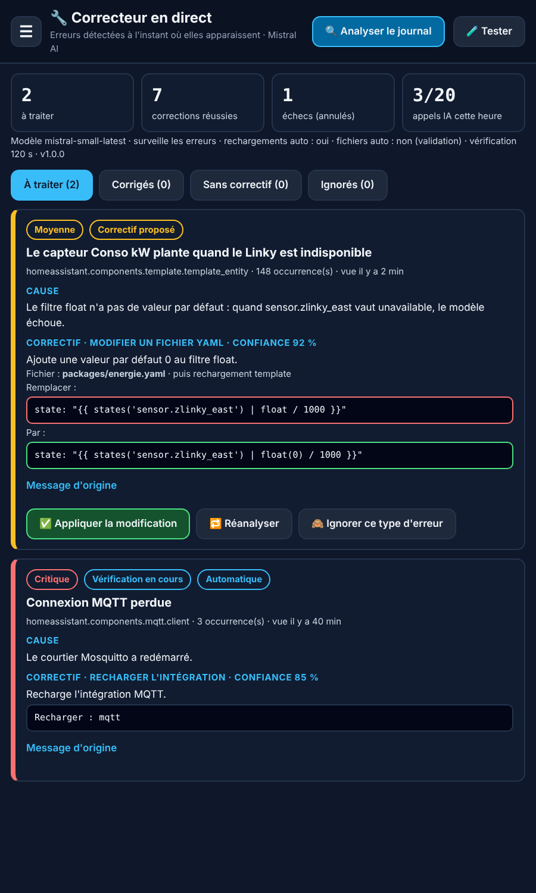

# 🔧 Correcteur en direct (Mistral) pour Home Assistant

Intégration HACS qui **surveille le journal de Home Assistant en direct** et corrige les erreurs
avec **Mistral AI**, dès qu'elles apparaissent, sans attendre une analyse programmée.

> Inspiré de [DomoLink-Mistral](https://github.com/SocrateMobile/DomoLink-Mistral), qui analyse le journal
> de 1 à 24 fois par jour. Ici, chaque nouvelle erreur est prise en charge dans la seconde.



## Ce que ça fait

1. **Détection instantanée** : l'intégration s'abonne au journal de Home Assistant. Une erreur écrite
   à 14 h 03 min 12 s est captée à 14 h 03 min 12 s.
2. **Regroupement** : une même erreur répétée 500 fois = un seul problème, une seule analyse IA
   (les nombres et horodatages sont ignorés pour reconnaître les doublons).
3. **Fichier en cause affiché en entier** : chemin complet et numéro de ligne
   (ex. `/config/packages/energie.yaml — ligne 4`), dans le panneau, les notifications et
   l'attribut `fichier` du capteur « Dernière erreur ».
4. **Contexte automatique** : les entités citées et les extraits YAML concernés (`packages/`,
   `automations.yaml`, `templates.yaml`…) sont retrouvés et envoyés avec l'erreur.
5. **Masquage local** avant tout envoi : mots de passe, jetons, clés API, adresses IP et MAC,
   e-mails, coordonnées GPS. `secrets.yaml` et `.storage/` ne sont jamais lus.
6. **Correction mixte** :
   | Type de correctif | Par défaut |
   |---|---|
   | Recharger une intégration ou un domaine YAML (`template.reload`…) | ✅ automatique |
   | Modifier un fichier YAML | 🔔 notification avec bouton **Appliquer** (automatique en option) |
   | Redémarrer Home Assistant | 🔔 jamais automatique |
7. **Vérification et retour arrière** : après chaque correction, l'erreur est surveillée pendant
   2 minutes. Si elle revient, le fichier sauvegardé est remis en place automatiquement
   et le problème passe en « Échec ».
8. **Contrôle de configuration** : après toute modification de fichier, la configuration est
   vérifiée. Si la modification ajoute une erreur, le fichier est restauré immédiatement.

## Installation

### Par HACS (recommandé)
1. HACS → menu ⋮ → **Dépôts personnalisés** → `https://github.com/xez7082/ha-correcteur-direct`,
   catégorie **Intégration**.
2. Installer **Correcteur en direct (Mistral)**, puis redémarrer Home Assistant.
3. Paramètres → Appareils et services → **Ajouter une intégration** → « Correcteur en direct ».
4. Coller votre clé API Mistral (gratuite sur [console.mistral.ai](https://console.mistral.ai) → *API Keys*).

### Manuelle
Copier `custom_components/correcteur_direct` dans `/config/custom_components/`, redémarrer, puis
ajouter l'intégration.

## Réglages

| Réglage | Défaut | Rôle |
|---|---|---|
| Modèle | `mistral-small-latest` | Suffit pour la plupart des erreurs |
| Niveau surveillé | Erreurs | Ou erreurs + avertissements (plus d'appels IA) |
| Rechargements automatiques | Oui | |
| Fichiers YAML automatiques | Non | Oui = modification sans demander (avec sauvegarde, contrôle et retour arrière) |
| Confiance minimale | 75 % | En dessous, le correctif est seulement proposé |
| Service de notification | vide | ex. `mobile_app_pixel_8` → notifications avec boutons **Appliquer / Ignorer** |
| Appels IA max / heure | 20 | Protège votre quota Mistral |
| Durée de vérification | 120 s | |
| Délai avant réanalyse | 6 h | Une erreur déjà analysée n'est pas renvoyée à l'IA avant ce délai |

## Panneau « Correcteur »

Un panneau apparaît dans la barre latérale (administrateurs) : onglets *À traiter*, *Corrigés*,
*Sans correctif*, *Ignorés*, avec pour chaque erreur la cause, le correctif proposé
(avant / après pour les fichiers) et des boutons de 52 px : **Appliquer**, **Annuler la modification**,
**Réanalyser**, **Ignorer**. Le bouton 🧪 **Tester** écrit une fausse erreur dans le journal pour
vérifier que la détection en direct fonctionne.

## Capteurs

- `sensor.correcteur_en_direct_problemes_detectes` : nombre de problèmes ouverts (attribut `critiques`, `liste`)
- `sensor.correcteur_en_direct_corrections_appliquees`
- `sensor.correcteur_en_direct_derniere_erreur` : résumé, cause et correctif de la dernière erreur

Exemple d'automatisation :

```yaml
automation:
  - alias: "Alerte erreur critique"
    triggers:
      - trigger: numeric_state
        entity_id: sensor.correcteur_en_direct_problemes_detectes
        attribute: critiques
        above: 0
    actions:
      - action: notify.mobile_app_mon_telephone
        data:
          title: "Erreur critique Home Assistant"
          message: "{{ states('sensor.correcteur_en_direct_derniere_erreur') }}"
```

## Services

`correcteur_direct.analyser_maintenant`, `appliquer_correctif`, `annuler_correctif`, `reanalyser`,
`ignorer`, `reactiver`, `vider_historique`, `tester`. Les services qui portent sur un problème
prennent son `id` (affiché dans le panneau).

## Sécurité

- Seuls des services de **rechargement** peuvent être appelés (liste blanche dans `const.py`).
- Les modifications de fichier : YAML uniquement, dans `/config`, hors `secrets.yaml`, `.storage`,
  `custom_components`, `www`… Le texte remplacé doit exister **une seule fois** dans le fichier.
- Une modification qui toucherait une valeur masquée est refusée.
- Sauvegardes dans `/config/correcteur_direct_sauvegardes/` (50 dernières conservées).
- Jamais de suppression d'entité, d'intégration ou de fichier ; jamais de redémarrage automatique.

## Limites

- Les intégrations et entrées créées par l'interface sont stockées dans `.storage` : l'IA peut alors
  expliquer quoi faire, ou recharger l'intégration, mais pas modifier leur configuration.
- Les erreurs écrites avant le chargement de l'intégration sont reprises au démarrage
  (3 minutes après) depuis le journal système.
- L'IA peut se tromper : c'est pour cela que les fichiers sont, par défaut, modifiés uniquement après
  votre accord.

## Licence

MIT
